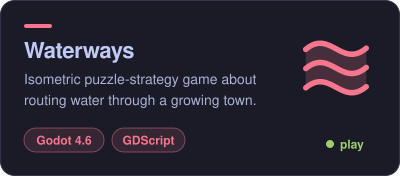
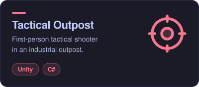
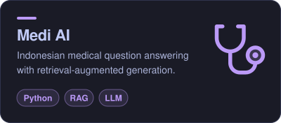
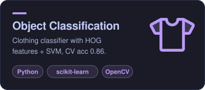
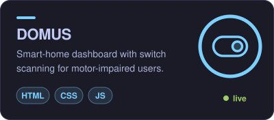
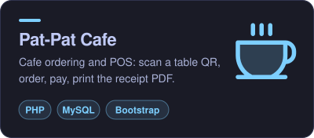
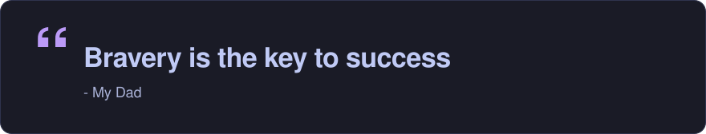

<picture>
  <source media="(prefers-color-scheme: dark)" srcset="https://readme-typing-svg.demolab.com?font=JetBrains+Mono&weight=500&size=18&pause=1400&color=7AA2F7&vCenter=true&width=600&height=40&lines=Building+game+mechanics+in+Unity+%26+Godot;Teaching+NPCs+to+patrol%2C+chase+and+flee;Shipping+accessible+web+apps;Student+%40+ITS+Surabaya"/>
  
</picture>

## About

I'm **Zhan**, a student at **Institut Teknologi Sepuluh Nopember** who builds things people can play with.

I split my time across three crafts that feed each other: **game mechanics** in Unity and Godot, **AI** from classic computer vision to retrieval-augmented LLMs, and **web apps** that ship to real users.

Right now I'm building **Tactical Outpost**, a first-person tactical shooter in Unity.

## Projects

**Game Mechanics**

**AI Engineering**

**Web Apps**

## Toolbox

  

  
  &nbsp;&nbsp;
  
  &nbsp;&nbsp;
  
  &nbsp;&nbsp;
  
  &nbsp;&nbsp;
  
  &nbsp;&nbsp;
  
  &nbsp;&nbsp;
  
  &nbsp;&nbsp;
  
  &nbsp;&nbsp;
  

## Activity

<picture>
  <source media="(prefers-color-scheme: dark)" srcset="https://github-readme-activity-graph.vercel.app/graph?username=Apasijannn&bg_color=1a1b26&color=a9b1d6&title_color=c0caf5&line=7aa2f7&point=bb9af7&area=true&area_color=7aa2f7&hide_border=true&radius=14"/>
  
</picture>

More activity

 

<picture>
  <source media="(prefers-color-scheme: dark)" srcset="https://streak-stats.demolab.com?user=Apasijannn&theme=tokyonight&hide_border=true&border_radius=14&background=1a1b26"/>
  
</picture>

## Commit Activity

<picture>
  <source media="(prefers-color-scheme: dark)" srcset="https://raw.githubusercontent.com/Apasijannn/Apasijannn/output/pacman-contribution-graph-dark.svg"/>
  
</picture>

## Philosophy

